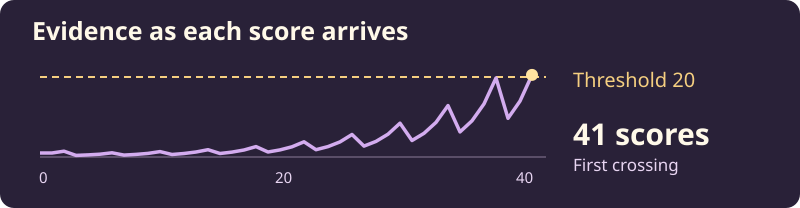

# eproc

**Decide when to stop a live evaluation.**

Put eproc between your evaluator and the scheduler that requests the next sample. It reads a stream of bounded scores, updates an e-value after each score, and signals when the evidence crosses your chosen threshold. Use the Python library inside an evaluation loop, pipe scores to the CLI, or call the same C11 engine from WebAssembly.

[Try the browser lab](https://pgg898200-ship-it.github.io/eproc/) · [Install the Python wheel](#install) · [Agent API guide](llms.txt)



## Run a stopping rule

The example uses a fixed trace so you can check your installation. For real evaluations, set the score bounds, null threshold, direction and error level before observing the scores.

```python
from eproc import EvalGate

gate = EvalGate(mu0=0.50, alpha=0.05, lower=0, upper=1, side="upper")
for score in [1, 1, 0, 1] * 12:
    gate.observe(score)
    if gate.should_stop:
        break

result = gate.summary()
print(result.verdict, result.n, round(result.e_value, 2))
# REJECT 41 20.52
```

Here the null hypothesis says that at every step the next score has conditional mean at most 0.50 given the history. Under this null and the stated score bounds, the probability that the e-value ever reaches 20 is at most 5%. Crossing rejects that null. If the run ends below threshold without an earlier crossing, the evidence is inconclusive. [Mathematical assumptions](docs/MATHEMATICS.md) · [Betting on bounded observations](https://arxiv.org/abs/2010.09686)

## Where it fits

| Your application | Input | eproc returns |
|---|---|---|
| LLM evaluations and CI | One bounded score per example, or candidate and baseline scores on the same prompt | A stopping decision from `EvalGate` or `PairedEvalGate` |
| Model selection | An arm ID and reward after each trial | Active arms and a winner when `AgentRace` separates their confidence bounds |
| Forecast monitoring | Residuals as labels arrive | Nested interval radii from `MultiRateConformal`, plus a mergeable 640-byte residual histogram with `ConformalMonoid` |
| Multiple forecasters or evidence feeds | Expert predictions and labels, or contributions tagged with provenance IDs | An updated forecast from `SafeFuser`, or a pooled belief from `EchoPool` |

In the repository’s simulation with a pass probability of 0.65 against a null of 0.50, the gate stopped after a median of 88 observations. The fixed-horizon reference used 857 observations and was sized for a smaller effect of 0.05. The benchmark counts evaluation calls. Token cost depends on what each call runs. [Benchmark conditions and measurements](benchmarks/BENCHMARKS.md)

## Install

### Python

Use the release wheel that matches your interpreter and platform. This installs the published 0.1.0 build directly from GitHub.

```sh
python -m pip install --no-index --only-binary=:all: --find-links https://github.com/pgg898200-ship-it/eproc/releases/expanded_assets/v0.1.0 eproc==0.1.0
```

If your platform has no matching wheel, build from the tagged source with a C compiler and Python development headers.

```sh
python -m pip install "eproc @ git+https://github.com/pgg898200-ship-it/eproc.git@v0.1.0"
```

[All release assets](https://github.com/pgg898200-ship-it/eproc/releases/tag/v0.1.0)

### Single-Header C11 / C++17 (1 file) or CMake `FetchContent`

Copy [`dist/eproc_single.h`](dist/eproc_single.h) into your project:

```c
#define EPROC_IMPLEMENTATION
#include "eproc_single.h"
// C11:   cc  -std=c11   -O3 -ffp-contract=off main.c   -lm   (runtime AVX2 auto-dispatched)
// C++17: c++ -std=c++17 -O3 -ffp-contract=off main.cpp -lm
```

Or link via CMake (`CMakeLists.txt` exposes `eproc::eproc` and `eproc::single_header`).

### WebAssembly + JS / TypeScript (`72 KiB`, zero Emscripten / WASI deps)

```js
import { initEproc, EProcess, ConformalMonoid } from "./js/eproc.mjs";

await initEproc("./dist/eproc.wasm"); // Works in Node.js, browsers, Cloudflare Workers, Bun, Deno
const ep = new EProcess({ mu0: 0.50, alpha: 0.05, lower: 0.0, upper: 1.0, side: "upper" });
const res = ep.updateBatch([1, 1, 0, 1, 1, 1]);
ep.free();
```

### Rust (zero Cargo deps) & Go (zero Go module deps)

- **Rust ([`rust/eproc/`](rust/eproc/)):** `cargo test --manifest-path rust/eproc/Cargo.toml --release` — compiles `csrc/` via `build.rs` with zero external crates and runtime AVX2.
- **Go ([`go/eproc/`](go/eproc/)):** `cd go/eproc && go test -race -v ./...` — self-contained CGo unity build with zero external modules and runtime AVX2.

### Coding Agents (MCP 2026-07-28 Server + Agent Skill)

```bash
eproc mcp   # Zero-dependency stdio MCP server (2025-11-25 & 2026-07-28, 7 stateful tools)
```

Drop-in manifests included for:
- **MCP Registry:** [`server.json`](server.json)
- **Claude Code:** [`.claude-plugin/plugin.json`](.claude-plugin/plugin.json) + [`skills/eproc/SKILL.md`](skills/eproc/SKILL.md)
- **Gemini CLI:** [`gemini-extension.json`](gemini-extension.json) + [`skills/eproc/SKILL.md`](skills/eproc/SKILL.md)
- **Codex / Cursor / Generic MCP Hosts:** `eproc mcp` (`eproc_etest`, `eproc_confidence_sequence`, `eproc_race`, `eproc_conformal`, `eproc_cmonoid_merge`, `eproc_safe_fuse`, `eproc_echopool`).

---

## Integration examples

### 1. Drop-In LLM Eval Gates, CI Assertions & Multi-Agent Racing

```python
from eproc import EvalGate, PairedEvalGate, AgentRace, assert_eprocess_uplift

# Track consumed samples against a fixed budget of 857
gate = EvalGate(mu0=0.50, alpha=0.05, lower=0.0, upper=1.0, fixed_horizon_n=857)
for score in live_eval_stream:
    gate.observe(score)
    if gate.should_stop:
        print(gate.summary())  # verdict="REJECT", n, e_value, p_value, samples_saved_pct
        break

# Drop-in paired A/B LLM eval gate (candidate vs baseline on identical prompts)
ab = PairedEvalGate(alpha=0.05, lower=0.0, upper=1.0)
ab.observe_pair(candidate=0.92, baseline=0.71)

# Test the predeclared upper-tail null in a pytest or CI run
assert_eprocess_uplift(scores, mu0=0.50, alpha=0.05)

# Compare eight arms with bounded rewards and a fixed conditional mean per arm
race = AgentRace(n_arms=8, alpha=0.05, lower=0.0, upper=1.0)
for _ in range(6400):  # example evaluation budget
    if race.winner is not None:
        break
    arm = race.suggest_arm()
    race.update(arm, run_agent_task(arm))
```

### 2. Crossing-Free Online Conformal, `sklearn` Wrapper & 640-Byte Fleet Monoid

```python
from eproc import MultiRateConformal, ConformalWrapper, ConformalMonoid, fleet_calibrate

# Calibrate 50/80/90/95/99% intervals simultaneously in 353 ns/step (0 quantile crossings)
cp = MultiRateConformal(alphas=(0.50, 0.20, 0.10, 0.05, 0.01), window_size=128, pid_ki=0.05)
pred = cp.predict(10.0, scale=1.0)       # pred.lows, pred.highs, pred.radii (nested)
cp.update(abs(y_true - 10.0))

# Drop-in sklearn / MAPIE-style online conformal wrapper around any regressor
wrapped = ConformalWrapper(my_regressor).fit(X_cal, y_cal)
y_hat, lows, highs = wrapped.predict_interval(X_test)

# Distributed fleet calibration: 640 bytes/agent, bit-exact abelian merge + LOO peer borrow
cal = fleet_calibrate([scores_agent_a, scores_agent_b, scores_agent_c], quantiles=(0.50, 0.90, 0.95))
wire_640b = cal.global_monoid.to_bytes() # fixed 640 bytes regardless of N scores
```

### 3. Combine expert forecasts and deduplicate evidence

```python
from eproc import SafeFuser, EchoPool

# Scale-Free BOA + 3-Gate Ville Non-Inferiority + Slim Boehm-2012 Lock-Free Seqlock
fuser = SafeFuser(n_experts=8, anchor_idx=0, alpha_deg=0.05)
step = fuser.update(expert_preds, y_true)   # quarantines 1e6/NaN Byzantine peers automatically
weights, fallback = fuser.snapshot()        # wait-free concurrent read (0 torn reads)

# Provenance-deduplicated log-odds pool + online Beta-Bernoulli peer reliability
pool = EchoPool(n_sources=8, n_claims=64, prior_prob=0.5)
out = pool.submit(source_id=3, claim_id=0, evidence_id="story-9001", llr=1.2)  # echoes dropped
pool.resolve(claim_id=0, outcome_positive=True)  # updates per-source reliability online
```

### 4. Causal Horvitz-Thompson Subsampling & 8,192-Channel `SiftVOI`

```python
from eproc import VarOptSampler, OnlineRLSSampler, SiftVOISelector

vo = VarOptSampler(k=256, seed=42)                # exact Cohen-2011 unbiased HT weights
rls = OnlineRLSSampler(d=16, oversample=2.0)      # 115 ns C11 Sherman-Morrison ridge leverage
sift = SiftVOISelector(n_sites=1024, per_site=8)  # division-free AVX2 Gaussian max-entropy B&B
```

### 5. Zero-Dependency CLI (`< 25 ms` startup)

```bash
cat evals.jsonl | eproc gate --mu0 0.50 --alpha 0.05 --side upper
cat tournament.jsonl | eproc race --arms 8 --alpha 0.05
cat residuals.jsonl | eproc conformal --alphas 0.5,0.2,0.1,0.05,0.01
eproc bench --quick
eproc version
```

---

## Verified Benchmarks `[LIVE-CPU]`

All numbers measured live on `Intel(R) Xeon(R) CPU @ 2.30GHz` (2 cores, AVX2+FMA, Python 3.12.16, GCC 13.3.0 `-std=c11 -O3 -ffp-contract=off`). Full provenance, Wilson/bootstrap CIs, and raw paired trials in [`benchmarks/receipts.json`](benchmarks/receipts.json), [`benchmarks/BENCHMARKS.md`](benchmarks/BENCHMARKS.md), and [`docs/COMPARISON.md`](docs/COMPARISON.md).

### Kernel Latency & Speedup vs Pure-Python Baselines (Median of 5 Paired Runs)

| Kernel | Pure Python (`ns/op`) | `eproc` Python API (`ns/op`) | `eproc` C11 Native (`ns/op`) | Throughput | Speedup vs Python |
|---|---:|---:|---:|---:|---:|
| **`ConformalMonoid.subtract` (exact LOO)** | 575,835 | **285.8** | — | 3.50 M/s | **2,015.0×** |
| **`MultiRateConformal` (5-rate AgACI+PID, batch)** | 83,691 | **353.5** | **350.1** | 2.86 M/s | **243.2×** |
| **`OnlineRLSSampler` (`d=16` Sherman-Morrison)** | 23,406 | **221.3** | **114.9** | 8.71 M/s | **203.8×** (C11) / **105.8×** (Py) |
| **`SiftVOISelector` (`2,048` ch exact B&B MI)** | 2,005,243 | **12,423** (`12.4 µs`) | **26,328** (sel+obs) | 80.5k/s | **161.4×** |
| **`EProcess` (ONS betting, batch / C11)** | 2,536 | **27.6** (scalar **118.5**) | **26.7** | **37.45 M/s** | **95.0×** (C11) / **21.4×** (Py) |
| **`EchoPool` (dedup + Beta-Bernoulli log-odds)** | 1,553 | **201.6** | **26.6** | **37.59 M/s** | **58.4×** (C11) / **7.7×** (Py) |
| **`SafeFuser` (8 experts + 3 Ville gates + Slim Seqlock)** | 25,832 | **569.9** | **445.7** | 2.24 M/s | **58.0×** (C11) / **45.3×** (Py) |
| **`ConformalMonoid.merge` (640 B AVX2)** | 1,609 | **219.5** | **34.2** | **29.26 M/s** | **47.1×** (C11) / **7.3×** (Py) |
| **`ConfidenceSequence` (Empirical-Bernstein)** | 2,615 | **65.0** (scalar **120.0**) | **62.8** | **15.94 M/s** | **41.7×** (C11) / **21.8×** (Py) |
| **`VarOptSampler` (`k=256` Cohen-2011 HT)** | 1,940 | **250.2** | **133.1** | 7.51 M/s | **14.6×** (C11) / **7.8×** (Py) |

*Portable wheel runtime CPUID AVX2 proof (`libeproc_portable.so`, compiled with zero `-mavx2` flags): `MultiRateConformal` **311.9 ns** vs `799.6 ns` forced scalar (**2.56× faster** out of the box, 0-ULP bit-identical).*

### End-to-End Multi-Agent & Distributed Benchmarks

| Benchmark | Incumbent / Naive Control | **`eproc`** | Verified Margin |
|---|---|---|---|
| **B1a: Continuous Peeking Null Safety (`N=2,000, T=1,000`)** | Student-t peeked every tick: **39.20% FPR** | **3.90% FPR** (Beta skewed: **4.00%**) | **10.1× fewer observed false positives** |
| **B1b: Early Stopping (`+0.15` uplift vs `N=857` fixed)** | `857` calls (0% saved) | **88 median calls**, rejection in all simulated trials | **9.74× fewer calls at the median** (**88.7% fewer calls on average**) |
| **B1c: `K=8` Agent Tournament (`100` runs)** | `6,400` calls fixed | **3,994 median calls**, **0.00% null FWER** | **1.60× faster** (**36.1% mean saved**) |
| **B3: 1,024-Agent Fleet Conformal (`512k` scores)** | `4.10 MB` raw, `11.85 ms` merge | **640 B**, **0.52 ms** Py / **62.2 µs** C11, **0 bin drift** | **6,400× smaller wire**, **190× faster C11** |
| **B4a: 8-Agent `1e6` Byzantine + Regime Shift** | Naive mean `10.42B`; Anchor `0.195` | Attack **`0.0220`**, post-shift **`0.0284`** | **-88.7% vs anchor** (`-85.0%` post-shift) |
| **B4b: 8-Agent 5× Echo + Byzantine Liar** | Naive vote Brier `0.3709` (skill `-0.484`, `1000` echoes) | Brier **`0.1483`** (skill **`+0.407`**, `0` echoes) | **`+0.89` Brier skill**, liar weight `-> 0.0` |
| **B5: 8,192-Channel Sparse Firehose (2% budget, 3× loud trap)** | Naive Top-Mean F1 **`0.100`** (`21.4` loud FA) | F1 **`0.752`** (`61.1%` recall, `98.1%` prec, **`0.0` loud FA**, `26.9 ms`) | **7.5× higher F1**, **0 wasted loud reads** |

---

## Verification, Sanitizers & Adversarial Breaker Discipline

`eproc` is verified across every language target in CI ([`.github/workflows/ci.yml`](.github/workflows/ci.yml)) and by an independent **42-test Adversarial Breaker** ([`tests/test_breaker.py`](tests/test_breaker.py), [`BREAKER_REPORT.md`](BREAKER_REPORT.md)):

- **Zero heap allocations:** `nm -u` confirms `0` references to `malloc`/`calloc`/`realloc`/`free` in `libeproc.so`, `libeproc_portable.so`, and `libeproc_scalar.so`.
- **3-way 0-ULP bit-identity:** Native `-march=native` AVX2, portable runtime-AVX2, and `-DEPROC_FORCE_SCALAR` pure scalar produce the exact same 64-bit state digest (`0xc1db7c3924a4bf25`), and `dist/eproc.wasm` produces bit-identical 640-byte `ConformalMonoid` wire payloads.
- **ASan + UBSan + `float-cast-overflow` + TSan + Go `-race`:** `0` errors across `±1e308`, subnormal `1e-310`, `NaN`, `±Inf`, and `2,000,000` concurrent Boehm-2012 seqlock reads (`0` torn reads).
- **Strict Causality (`assert_causal`):** `0.0` bitwise diff across all 10 engines under future `+1e15`/`NaN`/`Inf` perturbations.
- **11,500+ Adversarial Nulls:** Empirical Type-I error strictly `<= 0.05` across Bernoulli, boundary `0.01/0.99`, skewed Beta, and non-stationary adaptive Markov martingale nulls.

```bash
# Reproduce every check locally
make test && make test-asan && make test-tsan
PYTHONPATH=python python3 -m unittest discover -s tests -v
node --test js/test_wasm.mjs
RUSTFLAGS="-D warnings" cargo test --manifest-path rust/eproc/Cargo.toml --release
(cd go/eproc && go vet ./... && go test -race -v ./...)
python3 scripts/verify_release_hygiene.py --strict && sha256sum -c SHA256SUMS
```

---

## Documentation & Agent Discovery

- **[Live Interactive WASM Lab & Benchmarks](https://pgg898200-ship-it.github.io/eproc/)** ([`docs/index.html`](docs/index.html)) — Run real 72 KiB compiled C11 WebAssembly on your own data in the browser.
- [`docs/COMPARISON.md`](docs/COMPARISON.md) — Reproducible head-to-head comparison against `confseq`, `MAPIE`, `online_conformal`, `scipy.stats`, and `statsmodels`.
- [`docs/MATHEMATICS.md`](docs/MATHEMATICS.md) — Exact theorems, martingale proofs, and literature citations.
- [`benchmarks/BENCHMARKS.md`](benchmarks/BENCHMARKS.md) & [`benchmarks/receipts.json`](benchmarks/receipts.json) — Reproducible live benchmark report and raw JSON receipts.
- [`BREAKER_REPORT.md`](BREAKER_REPORT.md) — Independent 42-test adversarial red-team audit and resolution log.
- [`llms.txt`](llms.txt) & [`llms-full.txt`](llms-full.txt) — Machine-readable Markdown reference for AI coding agents.
- [`skills/eproc/SKILL.md`](skills/eproc/SKILL.md) & [`server.json`](server.json) — Drop-in Agent Skill & MCP Registry manifest.
- [`SHA256SUMS`](SHA256SUMS), [`SECURITY.md`](SECURITY.md), [`CONTRIBUTING.md`](CONTRIBUTING.md), [`CITATION.cff`](CITATION.cff), [`CHANGELOG.md`](CHANGELOG.md).

## License

Apache License 2.0 — see [`LICENSE`](LICENSE) and [`NOTICE`](NOTICE).
